# Custom Local LLM Playbook

A reusable guide for building domain-specialized models with LoRA fine-tuning, Ollama deployment, and continuous improvement from your own data. The WingBot LoL coach (`llm/projects/wingbot-lol/`) is the reference experiment; copy `llm/` into any project and follow the same workflow.

---

## 1. Philosophy: The Three-Layer Pattern

Avoid stuffing encyclopedic knowledge into the system prompt — context grows over long sessions and dilutes focus.

| Layer | Holds | Grows at runtime? |
|-------|-------|-------------------|
| **LoRA weights** | Domain facts: matchups, rules, playstyles, item logic | No |
| **Modelfile SYSTEM** | Behavior only: tone, format, length limits | No |
| **User message** | Compact structured state JSON (one snapshot per request) | No — replaced, not appended |

Each inference call is **stateless**: one JSON blob in, one short answer out. Optional RAG uses a **fixed token budget** (e.g. top-3 chunks, ~600 tokens) keyed by entity IDs — never unbounded history.

```
Bad:  system prompt + full chat history + pasted guides  →  context balloons
Good: fine-tuned model + fixed SYSTEM + compact state JSON  →  constant size
```

---

## 2. Prerequisites

| Tool | Purpose |
|------|---------|
| [Ollama](https://ollama.com) | Local inference, custom Modelfiles, OpenAI-compatible API |
| Python 3.10+ | Training scripts in `llm/core/` |
| NVIDIA GPU (optional but recommended) | LoRA training; RTX 5080 handles Gemma 4 E4B / 12B comfortably |
| HuggingFace account + token | Download base models (`huggingface-cli login`). Accept the license at [google/gemma-4-E4B-it](https://huggingface.co/google/gemma-4-E4B-it) then log in. `fallback_base_model` in `project.yaml` can point to Gemma 3 if needed. |

```bash
cd llm/core
python -m venv .venv
# Windows
.venv\Scripts\activate
# macOS/Linux
source .venv/bin/activate
pip install -r requirements.txt
```

Install [Ollama](https://ollama.com/download), then pull a base model for testing:

```bash
ollama pull gemma4:latest
```

---

## 3. New Project Checklist

1. Copy `llm/projects/_template/` → `llm/projects/<your-project>/`
2. Edit `project.yaml` — **`base_model` is required** (copy from `llm/defaults.yaml`), plus name, ollama tag, knowledge packs
3. Define `schemas/<input>.schema.json` — the compact runtime contract
4. Add knowledge under `knowledge/` (JSON, JSONL, or directories)
5. Run project-specific extractors if any (`scripts/`)
6. Merge knowledge: `python merge_knowledge.py --project <name>`
7. Build dataset: `python build_dataset.py --project <name>`
8. Train: `python train_lora.py --project <name>`
9. Export: `python export_ollama.py --project <name>`
10. Evaluate: `python eval.py --project <name>`
11. Register in `llm/registry.json`

---

## 4. Knowledge Packs

### Structure

```
knowledge/
├── ddragon/           # static snapshots (champions, items)
├── rules/             # exported heuristics (JSON)
├── matchups/          # curated edges (JSONL)
└── _merged/           # generated by merge_knowledge.py
    └── manifest.json
```

### Formats

**Matchup row** (`matchups.jsonl`):

```json
{
  "your_champ": "Diana",
  "enemy_champ": "Yasuo",
  "role": "mid",
  "lane_plan": "Trade after Wind Wall is down.",
  "itemization": ["Seeker's Armguard"],
  "playstyle": "aggressive_after_6",
  "win_condition": "All-in at 6 with ignite if no Flash."
}
```

**Item counter rule** (`rules/item_counters.json`):

```json
{
  "champion": "Yasuo",
  "items": [
    { "item": "Randuin's Omen", "reason": "Reduces crit damage", "priority": "high" }
  ]
}
```

### Merging packs

```bash
cd llm/core
python merge_knowledge.py --project wingbot-lol
python merge_knowledge.py --project wingbot-lol --add ../projects/wingbot-lol/knowledge/patch-15-12
```

Outputs `knowledge/_merged/manifest.json` with SHA-256 hashes per source file for reproducibility.

### Cross-project shared knowledge

Place reusable examples in `llm/projects/_shared/` (e.g. `decision_patterns.jsonl`). Reference them in `project.yaml` under `shared_datasets` or import during `build_dataset.py`.

---

## 5. Dataset Design

### Chat JSONL format

```json
{
  "messages": [
    { "role": "user", "content": "{\"phase\":\"in_game\",\"my_champ\":\"Diana\",...}" },
    { "role": "assistant", "content": "Rush Armguard. All-in at 6 when Wind Wall is down." }
  ]
}
```

### Build command

```bash
python build_dataset.py --project wingbot-lol
# Options: --eval-ratio 0.1 --seed 42
```

Produces `datasets/train.jsonl` and `datasets/eval.jsonl`. Inputs are validated against the project input schema.

### Replay buffer (incremental training)

When adding gameplay data, mix **20% of original `train.jsonl`** into each incremental batch to reduce catastrophic forgetting.

---

## 6. Training

### Initial LoRA

```bash
python train_lora.py --project wingbot-lol
# --epochs 3 --lora-rank 16 --dry-run  (validate config only)
```

Default hyperparameters (override in `project.yaml` → `train:`):

| Parameter | Default |
|-----------|---------|
| lora_rank | 16 |
| lora_alpha | 32 |
| epochs | 3 |
| max_seq_len | 2048 |
| learning_rate | 2e-4 |
| batch_size | 4 |

Adapter saved to `projects/<name>/adapters/v1/` (or next version).

### Incremental training (gameplay data)

```bash
# 1. Capture sessions
python ingest_gameplay.py --project wingbot-lol --from-fixture ../../test-data/league/

# 2. Review and approve
python ingest_gameplay.py --project wingbot-lol --review

# 3. Train from previous adapter
python incremental_train.py --project wingbot-lol --from-adapter v1 --output v2-personal
```

Rules:

- Always continue from **previous adapter**, not base model
- Cap incremental batches at ~500 new examples per run
- Include 20% replay from original train set
- Never overwrite `adapters/v1/` when creating `v2-personal`

### Adapter stacking

```
Gemma 4 E4B → LoRA v1 (general domain) → LoRA v2 (personal data) → merge at export → Ollama tag
```

---

## 7. Export to Ollama

```bash
python export_ollama.py --project wingbot-lol --adapter v1
# Creates GGUF (if llama.cpp available) or documents manual steps
# Runs: ollama create wingbot-lol -f ../projects/wingbot-lol/export/Modelfile
```

### Modelfile

```
FROM ./wingbot-lol-q4.gguf

PARAMETER temperature 0.4
PARAMETER top_p 0.9
PARAMETER num_ctx 4096

SYSTEM """You are WingBot, a League of Legends coach.
Input is compact JSON game state. Output 2-4 sentences of actionable advice."""
```

### Test inference

```bash
ollama run wingbot-lol
```

Or via HTTP:

```bash
curl http://127.0.0.1:11434/api/chat -d "{\"model\":\"wingbot-lol\",\"stream\":false,\"messages\":[{\"role\":\"user\",\"content\":\"{\\\"phase\\\":\\\"in_game\\\",\\\"my_champ\\\":\\\"Jinx\\\"}\"}]}"
```

### Naming conventions

| Tag | Meaning |
|-----|---------|
| `wingbot-lol` | Base domain model v1 |
| `wingbot-lol-v2` | Version bump |
| `wingbot-lol-personal` | Incremental / personal adapter |

---

## 8. Inference Contract

**Do:**

- Send one compact JSON object matching your input schema
- Keep responses to 2–4 sentences unless the schema asks for more
- Replace state each call; do not append prior game states to the prompt

**Do not:**

- Paste champion wiki text into the user message
- Maintain multi-turn chat history for coaching (v1)
- Grow the system prompt with per-game notes

Future WingBot integration: Rust builds `GameSnapshot` → strips to schema → `POST /v1/chat/completions` on Ollama.

---

## 9. Continuous Improvement

```mermaid
flowchart LR
  Play[Live session] --> Capture[ingest_gameplay.py]
  Capture --> Raw[datasets/gameplay/raw/]
  Raw --> Review[CLI review / approve]
  Review --> Approved[approved.jsonl]
  Approved --> Train[incremental_train.py]
  Train --> Adapter[adapters/vN+1]
  Adapter --> Export[export_ollama.py]
  Export --> Registry[registry.json bump]
```



### Capture record

```json
{
  "captured_at": "2026-06-15T20:30:00Z",
  "source": "wingbot_snapshot",
  "input": { "phase": "in_game", "my_champ": "Diana" },
  "model_output": "Rush Armguard, all-in at 6.",
  "human_label": "edited",
  "human_correction": "Wait for jungler gank at 5, then all-in.",
  "patch": "15.12"
}
```

Only rows with `human_label: "good"` or non-empty `human_correction` enter `approved.jsonl`.

### WingBot fixture ingestion

```bash
python ingest_gameplay.py --project wingbot-lol --from-fixture ../../test-data/league/
```

Reads JSON envelopes from `league_fixture_capture.rs` output format.

---

## 10. RAG (Optional)

Add only if fine-tune eval shows gaps on rare entities.

- Index static `matchups.jsonl` in Chroma or file lookup by champ name
- Retrieve **fixed K=3** chunks (~200 tokens each)
- Prepend to user message once; never add conversation history
- Rebuild index when knowledge packs change; **no retrain required**

Decision tree:

| Situation | Action |
|-----------|--------|
| Model forgets niche matchups | Fixed-budget RAG |
| Wrong advice on new patch | Update knowledge pack + incremental train |
| Wrong tone/format | Adjust Modelfile SYSTEM only |
| Broad domain gap | Add training examples + full retrain |

---

## 11. Multi-Model Management

`llm/registry.json` tracks all models:

```json
{
  "models": [
    {
      "ollama_tag": "wingbot-lol",
      "project": "wingbot-lol",
      "version": "1.0.0",
      "adapter": "projects/wingbot-lol/adapters/v1",
      "eval_score": 0.84
    }
  ],
  "active": { "wingbot-lol": "wingbot-lol" }
}
```

### A/B testing

Run eval on both tags, compare scores, update `active` pointer.

### Rollback

```bash
ollama run wingbot-lol-v1
# Update registry active pointer
```

---

## 12. LoL Experiment Reference (`wingbot-lol`)

| Step | Command |
|------|---------|
| Extract Data Dragon | `python projects/wingbot-lol/scripts/extract_ddragon.py` |
| Export WingBot rules | `python projects/wingbot-lol/scripts/export_wingbot_rules.py` |
| Merge knowledge | `python core/merge_knowledge.py --project wingbot-lol` |
| Build dataset | `python core/build_dataset.py --project wingbot-lol` |
| Train | `python core/train_lora.py --project wingbot-lol` |
| Export | `python core/export_ollama.py --project wingbot-lol` |
| Eval | `python core/eval.py --project wingbot-lol` |

Input schema: `projects/wingbot-lol/schemas/game_state.schema.json`

Knowledge sources:

- `item_analyzer.rs` → `knowledge/rules/item_counters.json`
- `game.rs` → `knowledge/rules/champion_edges.json`
- Data Dragon → `knowledge/ddragon/`
- Curated → `knowledge/matchups/matchups.jsonl`

---

## 13. Other Application Sketches

### Code review bot

```yaml
# project.yaml
name: my-code-review
base_model: <see llm/defaults.yaml>
ollama_tag: code-review
input_schema: schemas/diff.schema.json
```

```json
// diff.schema.json
{ "language": "rust", "file": "src/lib.rs", "diff_hunk": "...", "focus": "error_handling" }
```

Knowledge: style guide markdown, lint rules JSON, example review comments JSONL.

### Personal notes assistant

```json
{ "query": "summarize", "tags": ["work", "2026"], "note_ids": ["n1", "n2"] }
```

Knowledge: exported notes as JSONL chunks. Incremental train weekly from approved captures.

---

## Quick Reference

| Script | Purpose |
|--------|---------|
| `merge_knowledge.py` | Union knowledge packs → manifest |
| `build_dataset.py` | Knowledge → train/eval JSONL |
| `train_lora.py` | Initial LoRA fine-tune |
| `incremental_train.py` | Continue from adapter + replay |
| `export_ollama.py` | Adapter → GGUF → `ollama create` |
| `eval.py` | Held-out metrics |
| `ingest_gameplay.py` | Capture + review workflow |
| `ingest_feedback.py` | Append single approved example |

See also: [`llm/README.md`](../llm/README.md) for quick-start commands.  
**Follow-along status & checklist:** [`docs/LLM_PIPELINE.md`](../docs/LLM_PIPELINE.md)
