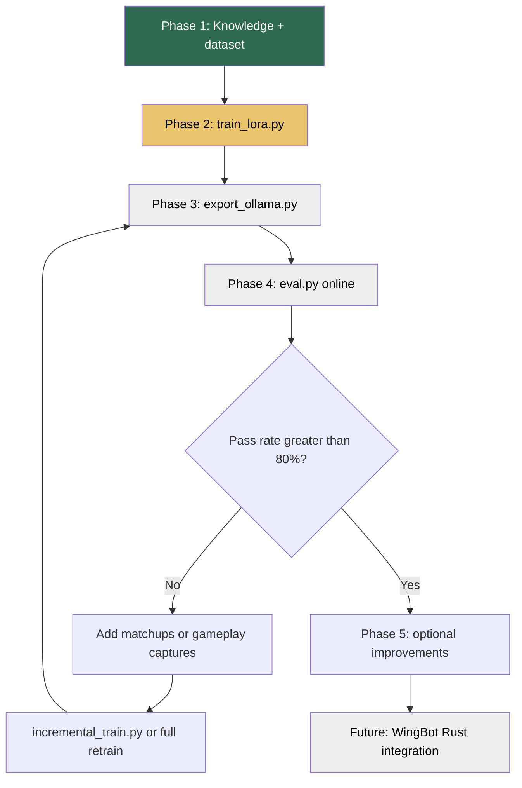

# WingBot LLM Pipeline — Status & Follow-Along Guide

Practical doc for running and finishing the local LoL coaching model. For the reusable methodology (new projects, RAG, incremental training), see **[CUSTOM_LLM_PLAYBOOK.md](./CUSTOM_LLM_PLAYBOOK.md)**.

---

## Doc map

| Document | Use when |
|----------|----------|
| **[LLM_PIPELINE.md](./LLM_PIPELINE.md)** (this file) | Current status, commands, checklist, what's left |
| **[CUSTOM_LLM_PLAYBOOK.md](./CUSTOM_LLM_PLAYBOOK.md)** | Building other domain models, knowledge merging, architecture |
| **[llm/README.md](../llm/README.md)** | Quick command reference |

---

## What this pipeline does

Build a **domain-specialized local model** that already knows LoL matchups, items, and playstyles — so at runtime you only send a **small fixed JSON game state**, not growing instructions.

```
Knowledge + matchups  →  train.jsonl  →  LoRA fine-tune (Gemma 3 4B)
                                              ↓
                                    Ollama model (wingbot-lol)
                                              ↓
                         Compact GameState JSON in → short advice out
```

**Design rule:** each request is stateless. No chat history, no pasted guides. See the three-layer pattern in the playbook.

---

## Current status (June 2026)

| Area | Status |
|------|--------|
| `llm/` framework + core scripts | Done |
| Playbook + this guide | Done |
| Knowledge extraction (ddragon, rules, 117 matchups) | Done |
| Dataset (474 train / 52 eval) | Done |
| Offline eval (format validation) | Done — 52/52 passed |
| Gameplay ingest workflow | Done (scripts + 2 sample captures) |
| HuggingFace + Gemma 4 access | Done (you logged in + accepted terms) |
| Ollama placeholder `wingbot-lol` | Done (uses `gemma4:latest` + system prompt only) |
| **LoRA training `adapters/v1/`** | **Not finished** — training was interrupted during model load |
| Export merged GGUF | Not done (needs trained adapter) |
| Online eval vs Ollama | Not done |
| WingBot Rust/UI integration | Not started (out of scope for pipeline v1) |

**Bottom line:** infrastructure is ~90% done. The one critical step is letting `train_lora.py` finish and produce `adapters/v1/adapter_model.safetensors`. Everything else (export, online eval, incremental training, WingBot hookup) depends on that.

---

## Progress at a glance



You are on **Phase 2** (yellow). Phases 1 and setup are green.

---

## Definition of done (per phase)

| Phase | Done when | Verify |
|-------|-----------|--------|
| 1 — Knowledge | `train.jsonl` + `eval.jsonl` exist | `eval.py --offline` → 52/52 |
| 2 — Train | `adapters/v1/adapter_model.safetensors` exists | `train_config.json` shows `google/gemma-3-4b-it` |
| 3 — Export | `ollama list` shows `wingbot-lol`; `export/Modelfile` updated | `ollama run wingbot-lol` returns advice for test JSON |
| 3b — GGUF (optional) | `export/wingbot-lol-q4_k_m.gguf` exists | Modelfile `FROM ./wingbot-lol-q4_k_m.gguf` |
| 4 — Online eval | `eval_report.json` mode `online`, pass_rate ≥ 0.8 | `registry.json` `eval_score` populated |
| 5 — Incremental | `adapters/v2-personal/` exists | Separate Ollama tag or registry bump |

---

## Repo layout

```
llm/
├── defaults.yaml                 # base_model + ollama_base_model
├── registry.json                 # model versions (updates after train/export)
├── run_pipeline.ps1              # optional one-shot runner
├── core/                         # python scripts (--project wingbot-lol)
│   ├── build_dataset.py
│   ├── train_lora.py
│   ├── export_ollama.py
│   ├── eval.py
│   ├── merge_knowledge.py
│   ├── ingest_gameplay.py
│   ├── incremental_train.py
│   └── ingest_feedback.py
└── projects/
    ├── _template/                # copy for new domains
    └── wingbot-lol/
        ├── project.yaml
        ├── schemas/game_state.schema.json
        ├── knowledge/
        ├── datasets/
        ├── adapters/             # ← LoRA checkpoints land here
        └── export/Modelfile
```

---

## One-time setup

```powershell
cd d:\production\rust\wingbot\llm\core
python -m venv .venv
.venv\Scripts\activate

# CUDA PyTorch FIRST (RTX 50xx → cu128; older GPUs → cu124)
pip install torch --index-url https://download.pytorch.org/whl/cu128
pip install -r requirements.txt

# Must show +cu128 and True — NOT +cpu
python -c "import torch; print(torch.__version__, torch.cuda.is_available())"
```

HuggingFace (required for Gemma 4):

```powershell
huggingface-cli login
```

Accept the license at [google/gemma-4-E4B-it](https://huggingface.co/google/gemma-4-E4B-it).

Ollama — you should already have `gemma4:latest`. Verify:

```powershell
ollama list
```

---

## Follow-along checklist

### Phase 1 — Knowledge & dataset (done)

Skip unless refreshing after a patch or adding matchups.

```powershell
cd d:\production\rust\wingbot\llm\core
.venv\Scripts\activate

python ..\projects\wingbot-lol\scripts\extract_ddragon.py
python ..\projects\wingbot-lol\scripts\export_wingbot_rules.py
python ..\projects\wingbot-lol\scripts\generate_matchups.py
python merge_knowledge.py --project wingbot-lol
python build_dataset.py --project wingbot-lol
python eval.py --project wingbot-lol --offline
```

**Outputs:** `datasets/train.jsonl`, `datasets/eval.jsonl`

To add your own matchup knowledge, edit:

`llm/projects/wingbot-lol/knowledge/matchups/matchups.jsonl`

Then re-run `build_dataset.py`.

---

### Phase 2 — Train LoRA (you are here)

This is the main remaining step. Let it run to completion without closing the terminal.

```powershell
cd d:\production\rust\wingbot\llm\core
.venv\Scripts\activate

# Full training (3 epochs in project.yaml, ~30–90 min on RTX 5080)
python train_lora.py --project wingbot-lol

# Faster first pass
python train_lora.py --project wingbot-lol --epochs 1
```

**Success looks like:**

```
Adapter saved to ...\llm\projects\wingbot-lol\adapters\v1\
```

Files inside `v1/`: `adapter_config.json`, `adapter_model.safetensors`, `train_config.json`, tokenizer files.

`registry.json` updates automatically with the model that actually trained (usually `google/gemma-4-E4B-it`).

#### Hardware & disk (RTX 5080)

| Resource | Estimate |
|----------|----------|
| VRAM during QLoRA | ~8–12 GB |
| First-run HF download | ~9 GB (cached under `%USERPROFILE%\.cache\huggingface`) |
| Adapter output (`v1/`) | ~50–200 MB |
| Full train (3 epochs, 474 examples) | ~30–90 min |

#### Smoke test before a full run

```powershell
# Validate config only — no GPU work
python train_lora.py --project wingbot-lol --dry-run

# Quick train on 80 examples, 1 epoch (~5–15 min)
python train_lora.py --project wingbot-lol --max-samples 80 --epochs 1
```

#### Run with logging (survives terminal close)

Use a dedicated terminal and log output:

```powershell
python train_lora.py --project wingbot-lol 2>&1 | Tee-Object -FilePath train_run.log
```

Do not close the window until you see `Adapter saved to ...\adapters\v1\`.

#### Fallback model

`project.yaml` sets `fallback_base_model: google/gemma-3-4b-it`. If Gemma 4 fails to load, training continues on Gemma 3 4B automatically. Check `adapters/v1/train_config.json` → `base_model` to see which ran.

#### Training troubleshooting

| Symptom | Fix |
|---------|-----|
| `doesn't support bf16/gpu` | Pull latest code (auto fp16 fallback + single-GPU device map). If still failing: `python -c "import torch; print(torch.cuda.is_available())"` — if False, reinstall CUDA PyTorch |
| `Gemma4ClippableLinear is not supported` | Use default `google/gemma-3-4b-it` in project.yaml (now the default). Gemma 4 is experimental |
| Stops at "Loading weights" (~60–65%) | Session was interrupted — re-run; use `Tee-Object` logging above |
| `401 Unauthorized` / gated repo | `huggingface-cli login`; re-accept [gemma-4-E4B-it terms](https://huggingface.co/google/gemma-4-E4B-it) |
| CUDA OOM | Lower `batch_size` in `project.yaml` (try 2) or use `--max-samples 200 --epochs 1` first |
| `Training deps missing` | `pip install -r requirements.txt` inside `.venv` |
| Empty `adapters/v1/` (dir only) | Training never finished — no resume yet; start fresh |
| Registry shows `gemma-3-4b-it` | Stale entry from a partial export — overwritten after next successful train |

---

### Phase 3 — Export to Ollama

```powershell
python export_ollama.py --project wingbot-lol --skip-merge
```

- Without GGUF: recreates `wingbot-lol` in Ollama using `gemma4:latest` + your SYSTEM prompt (behavior only, not LoRA weights).
- With GGUF (see below): full custom weights in Ollama.

#### Phase 3b — Full GGUF export (recommended after v1 trains)

Placeholder export (`--skip-merge`) only changes the Modelfile SYSTEM prompt — **not** your LoRA knowledge. For a true custom model:

```powershell
# Merge adapter + convert GGUF + ollama create (needs llama.cpp on PATH)
python export_ollama.py --project wingbot-lol

# If auto-convert fails, follow the generated file:
# projects/wingbot-lol/export/EXPORT_INSTRUCTIONS.md
```

Manual fallback (from `EXPORT_INSTRUCTIONS.md`):

1. Merge LoRA into base weights (PEFT) → `export/merged/` (or `python export_ollama.py --project wingbot-lol`)
2. **Step A** — convert to F16 GGUF:
   ```powershell
   python C:\tools\llama.cpp\convert_hf_to_gguf.py `
     D:\production\rust\wingbot\llm\projects\wingbot-lol\export\merged `
     --outfile D:\production\rust\wingbot\llm\projects\wingbot-lol\export\wingbot-lol-f16.gguf `
     --outtype f16
   ```
3. **Step B** — quantize to Q4_K_M (requires built `llama-quantize`):
   ```powershell
   C:\tools\llama.cpp\build\bin\Release\llama-quantize.exe `
     D:\production\rust\wingbot\llm\projects\wingbot-lol\export\wingbot-lol-f16.gguf `
     D:\production\rust\wingbot\llm\projects\wingbot-lol\export\wingbot-lol-q4_k_m.gguf `
     Q4_K_M
   ```
   **Shortcut (one step, ~2× larger):** use `--outtype q8_0` in step A and skip step B; point Modelfile at that file.
4. `cd projects/wingbot-lol/export && ollama create wingbot-lol -f Modelfile`

Test inference:

```powershell
ollama run wingbot-lol
```

Example input (paste as user message):

```json
{"phase":"in_game","my_champ":"Diana","my_role":"mid","enemies":["Yasuo"],"game_time_sec":600,"gold_diff":0,"my_items":[],"queue":"ranked_solo","patch":"16.12"}
```

Or via HTTP:

```powershell
curl http://127.0.0.1:11434/api/chat -d "{\"model\":\"wingbot-lol\",\"stream\":false,\"messages\":[{\"role\":\"user\",\"content\":\"{\\\"phase\\\":\\\"in_game\\\",\\\"my_champ\\\":\\\"Diana\\\",\\\"my_role\\\":\\\"mid\\\",\\\"enemies\\\":[\\\"Yasuo\\\"],\\\"game_time_sec\\\":600,\\\"gold_diff\\\":0,\\\"my_items\\\":[],\\\"queue\\\":\\\"ranked_solo\\\",\\\"patch\\\":\\\"16.12\\\"}\"}]}"
```

---

### Phase 4 — Evaluate

```powershell
# Offline — validates eval.jsonl format (already passed)
python eval.py --project wingbot-lol --offline

# Online — queries Ollama, scores responses
python eval.py --project wingbot-lol
```

Target: **>80% pass rate** on held-out eval before wiring into WingBot.

Report written to: `projects/wingbot-lol/datasets/eval_report.json`

#### How online scoring works

Each eval prompt sends the user JSON to Ollama and scores the response on:

| Signal | Weight | Pass threshold |
|--------|--------|----------------|
| Keyword overlap with expected answer | 50% | Combined score ≥ 0.4 |
| Champion name mentions from input JSON | 30% | Response 5–100 words |
| Response length (2–4 sentence target) | 20% | Not too long (>100 words fails) |

Offline eval only checks that eval rows have valid input JSON and reasonable expected answer length — it does **not** call the model.

Requires Ollama running (`ollama serve` or the desktop app) and the `wingbot-lol` tag present.

---

### Phase 5 — Improve over time (optional)

**Add matchup data** → rebuild → retrain:

```powershell
# Edit knowledge/matchups/matchups.jsonl, then:
python build_dataset.py --project wingbot-lol
python train_lora.py --project wingbot-lol
python export_ollama.py --project wingbot-lol --skip-merge
```

**Capture gameplay sessions** → incremental personal adapter:

```powershell
# From WingBot test fixtures or future app hooks
python ingest_gameplay.py --project wingbot-lol --from-fixture ..\..\test-data\league

# Review: set human_label to "good" or add human_correction in raw JSONL, then:
python ingest_gameplay.py --project wingbot-lol --promote

# Train on top of v1 (requires adapters/v1/ to exist)
python incremental_train.py --project wingbot-lol --from-adapter v1 --output v2-personal
python export_ollama.py --project wingbot-lol --adapter v2-personal
```

**Single manual example:**

```powershell
python ingest_feedback.py --project wingbot-lol `
  --input-json '{"phase":"in_game","my_champ":"Diana","my_role":"mid","enemies":["Yasuo"],"queue":"ranked_solo"}' `
  --response "Trade when Wind Wall is down. All-in at 6 with ignite."
```

---

## Runtime input contract

All inference uses compact JSON matching `projects/wingbot-lol/schemas/game_state.schema.json`:

```json
{
  "phase": "champ_select | in_game | post_game",
  "my_champ": "Diana",
  "my_role": "mid",
  "allies": ["..."],
  "enemies": ["Yasuo"],
  "game_time_sec": 600,
  "gold_diff": -200,
  "my_items": ["Seeker's Armguard"],
  "enemy_threats": ["Yasuo"],
  "queue": "ranked_solo",
  "patch": "16.12"
}
```

This mirrors WingBot `GameSnapshot` but stripped — no raw LCU blobs.

---

## Key config files

| File | What to edit |
|------|----------------|
| `llm/defaults.yaml` | Repo-wide `base_model`, `ollama_base_model` |
| `llm/projects/wingbot-lol/project.yaml` | Per-project model, LoRA hyperparams, knowledge packs |
| `llm/projects/wingbot-lol/export/system.txt` | Coach behavior (tone, length) |
| `llm/projects/wingbot-lol/export/Modelfile` | Ollama parameters + SYSTEM |
| `llm/registry.json` | Auto-updated model versions |

**Current defaults:**

- HuggingFace: `google/gemma-3-4b-it` (train)
- Ollama base (until custom GGUF): `gemma4:latest` (inference placeholder)
- Ollama tag: `wingbot-lol`

---

## Gotchas

1. **`gemma4:4b` does not exist in Ollama** — use `gemma4:latest` (set in `defaults.yaml`).
2. **Training was interrupted before** — no `adapters/v1/` yet; re-run `train_lora.py` and let it finish.
3. **Data Dragon files are gitignored** (`llm/.gitignore`) — run `extract_ddragon.py` on a fresh clone.
4. **Placeholder `wingbot-lol` ≠ fine-tuned model** — until GGUF export, Ollama uses base Gemma 4 + your system prompt only.
5. **Gemma is gated on HuggingFace** — keep `huggingface-cli login` valid after token expiry.
6. **No training resume yet** — if interrupted, `train_lora.py` starts from scratch.
7. **`registry.json` may show `gemma-3-4b-it`** — from an export run before Gemma 4 training completed; it self-corrects after the next successful train.
8. **Gameplay captures use numeric champ IDs** in fixtures (`"my_champ":"143"`) — training examples from `build_dataset.py` use names; normalize in ingest or edit approved rows before incremental train.
9. **Gemma 4 + old PEFT target list** — Gemma 4 has vision/audio layers that break bare `q_proj` targeting; `train_lora.py` now scopes LoRA to the language model. If it still fails, it auto-falls back to `google/gemma-3-4b-it`.

---

## Artifact reference

| Path | Created by | Purpose |
|------|------------|---------|
| `knowledge/_merged/manifest.json` | `merge_knowledge.py` | SHA-256 audit of knowledge sources |
| `datasets/train.jsonl` | `build_dataset.py` | 474 training examples |
| `datasets/eval.jsonl` | `build_dataset.py` | 52 held-out examples |
| `datasets/eval_report.json` | `eval.py` | Latest offline or online scores |
| `datasets/gameplay/raw/` | `ingest_gameplay.py` | Captures awaiting review |
| `datasets/gameplay/approved.jsonl` | `ingest_gameplay.py --promote` | Human-approved rows for incremental train |
| `adapters/v1/` | `train_lora.py` | LoRA checkpoint (empty until train completes) |
| `export/Modelfile` | `export_ollama.py` | Ollama model definition |
| `export/EXPORT_INSTRUCTIONS.md` | `export_ollama.py` | GGUF merge steps if auto-export failed |
| `registry.json` | train / export / eval | Model versions and active Ollama tag |

---

## Future: WingBot integration

When the model eval passes, wire into the Tauri app:

1. `OllamaConfig` in `src-tauri/src/config.rs` (`base_url`, `model_name: "wingbot-lol"`)
2. New `llm_service.rs` → `POST http://127.0.0.1:11434/v1/chat/completions`
3. Rust `build_compact_game_state(GameSnapshot)` → JSON per schema above
4. Replace static `AIRecommendations.svelte` with live Ollama calls
5. Settings page: Ollama URL, model tag, test connection

No Python `wingbot_server` needed — Ollama replaces it.

---

## New domain (not LoL)

```powershell
cp -r llm\projects\_template llm\projects\my-app
# Edit project.yaml (base_model required), schemas/, knowledge/
cd llm\core
python merge_knowledge.py --project my-app
python build_dataset.py --project my-app
python train_lora.py --project my-app
python export_ollama.py --project my-app
```

See **[CUSTOM_LLM_PLAYBOOK.md](./CUSTOM_LLM_PLAYBOOK.md)** for full methodology.

---

## Quick reference — all commands

```powershell
cd d:\production\rust\wingbot\llm\core
.venv\Scripts\activate

# Full pipeline from scratch
python ..\projects\wingbot-lol\scripts\extract_ddragon.py
python ..\projects\wingbot-lol\scripts\export_wingbot_rules.py
python ..\projects\wingbot-lol\scripts\generate_matchups.py
python merge_knowledge.py --project wingbot-lol
python build_dataset.py --project wingbot-lol
python train_lora.py --project wingbot-lol
python export_ollama.py --project wingbot-lol --skip-merge
python eval.py --project wingbot-lol

# Or use the runner (add -Train to include train + export)
cd d:\production\rust\wingbot\llm
.\run_pipeline.ps1 -Project wingbot-lol -Train
```

---

## Next action

Run Phase 2 in a dedicated terminal and let it finish:

```powershell
cd d:\production\rust\wingbot\llm\core
.venv\Scripts\activate
python train_lora.py --project wingbot-lol 2>&1 | Tee-Object -FilePath train_run.log
```

When `Adapter saved to ...\adapters\v1\` appears, continue with Phase 3 → 4 in order. If eval passes (>80%), the pipeline v1 experiment is complete and you can optionally wire WingBot or start incremental personal training (Phase 5).
